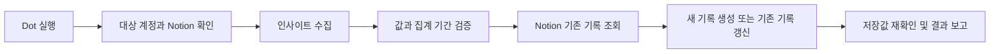

# Auto-IG-Notion

OpenAI Dot이 Instagram 프로페셔널 계정의 인사이트를 수집하고 Notion 데이터베이스에 기록하는 자동화 프로세스입니다.

저장소: https://github.com/leeseongwo0/Auto-IG-Notion

현재는 **새 Notion 구성 명세와 Dot 실행 자료를 준비한 단계**입니다. 실제 Notion 페이지·DB 생성, 로그인 연동, 데이터 기록, 예약 실행은 아직 검증하지 않았습니다.

## 화면 프로토타입

[인터랙티브 프로토타입](prototype/index.html)을 브라우저에서 열면 대시보드, 콘텐츠 캘린더, 계정 추이와 수집 상태의 사용 흐름을 확인할 수 있습니다. 하나의 HTML 파일로 동작하며 별도 설치·서버가 필요하지 않습니다. 모든 지표는 가상 샘플이며 실제 Instagram·Notion 연결은 수행하지 않습니다. 이는 Notion 구성 방향을 확인하기 위한 웹 목업입니다.

## 확정된 범위

- 실행 담당: OpenAI Dot.
- 지표 원본: Meta Business Suite 우선, 필요한 경우 Instagram 인사이트로 보완.
- 대상: 사용자가 인사이트를 볼 수 있는 Instagram 프로페셔널 계정. 실제 대상은 로컬 설정에서 지정합니다.
- 계정 요약: 팔로워 수, 조회, 도달.
- 게시물·릴스: 조회, 도달, 좋아요, 댓글, 저장, 공유 중 실제로 제공되는 지표.
- 기록 위치: 지정한 상위 페이지 아래에 새 `Instagram 성과` 대시보드와 콘텐츠·콘텐츠 지표·계정 지표 DB를 구성합니다.
- 최초 수집: 접근 가능한 기존 지표를 수집합니다. 기존 Notion 자료 이관은 제외합니다.

## 실행 흐름



## 사용할 문서

- [워크플로와 데이터 규칙](docs/workflow.md): 수집 범위, Notion 매핑, 중복 방지, 오류 복구.
- [Dot 최종 전달 지침](prompts/dot-handoff.md): 파일 접근 없이도 실행할 수 있는 통합 작업 지시 템플릿.
- [Dot 최초 구성 지침](prompts/dot-bootstrap.md): 새 대시보드와 DB 생성, 첫 수집 검증.
- [Dot 반복 실행 지침](prompts/dot-task.md): 구성된 DB에 지표 기록.
- [기존 지표 최초 수집](docs/initial-import.md): 과거 콘텐츠·기간 통계를 처음 가져오고 중단 후 이어가는 규칙.
- [Notion 구성 명세](docs/notion-layout.md)와 [속성·보기 정의](notion/schema.json): 생성할 구조와 정확한 속성 이름·유형.

## 시작에 필요한 정보

1. 로컬 대상 설정. 처음 사용할 때만 [설정 예제](config/example.json)를 `config/local.json`에 복사하고 계정과 `parent_page_url`을 입력합니다. 생성 전의 대시보드·DB URL은 `null`로 둡니다. 기존 로컬 파일을 덮어쓰지 않습니다.
2. Dot에서 상위 Notion 페이지에 하위 페이지·DB를 생성할 수 있는 연결과 Business Suite에서 대상 Instagram 인사이트를 조회할 권한. 별도 Instagram 연결은 필요한 지표를 보완할 때 사용합니다.

기존 캘린더의 속성 목록은 필요하지 않습니다. 새 구성을 사용할 때는 다음 명령으로 실제 대상 정보와 모든 지침을 묶은 전달본을 만듭니다.

```bash
cd /workspace/Auto-IG-Notion
python3 scripts/prepare_dot.py
```

생성된 `runtime/dot-handoff.md`는 단독으로 전달할 통합 작업 지시이고, `runtime/dot-setup.md`는 전체 속성 명세와 참고 문서까지 포함한 상세본입니다. Notion에 접근할 수 있는 Dot에 내용을 복사하거나 접근 가능한 방식으로 전달합니다. 이 명령은 로컬 문서만 생성하며 외부 서비스에 요청하지 않습니다. 전달본에는 실제 대상 주소가 있으므로 공개 저장소에 추가하지 않습니다. Dot은 실제 생성한 대시보드·DB URL을 보고하고, 파일에 접근할 수 있으면 `config/local.json`에 저장합니다.

GitHub에는 작업 지침·구성 명세·샘플 프로토타입·설정 예제만 포함합니다. 실제 대상 설정과 생성된 전달본은 Git에서 제외되므로 다른 Dot 실행에 자동으로 공유되지 않습니다. Dot에는 이 저장소 주소와 함께 실제 계정·상위 Notion 페이지를 별도로 전달하고, `prompts/dot-handoff.md`와 `notion/schema.json`을 읽도록 지정합니다. 웹 프로토타입은 다운로드하여 볼 수 있는 샘플이며 공개 웹주소로 배포된 서비스는 아닙니다.

최초 수집에서는 최근 30일 콘텐츠를 우선 처리한 뒤 접근 가능한 과거 콘텐츠·기간 통계까지 진행합니다. 이후 정기 수집 제안은 **매일 오전 9시(Asia/Seoul), 최근 30일 내 게시한 콘텐츠**입니다. 실제 예약은 Dot에서 지원하는 실행 방식과 사용자 일정을 확인한 뒤 설정합니다. 계정 인사이트의 집계 기간은 화면 또는 연결 도구에서 지원하는 범위를 확인해 고정합니다.

전달본 생성은 Python 3 표준 라이브러리만 사용하며, 별도 패키지나 서버가 필요하지 않습니다. 각 클라우드 작업은 이미 격리되어 있으므로 기존 체크아웃을 사용하고, 사용자가 요청하지 않는 한 Git worktree를 추가하지 않습니다.

## 공개 저장소 사용

자동화 지침과 값이 비어 있는 설정 예제는 공개할 수 있습니다. 실제 대상 계정·Notion 주소는 Git에서 제외한 `config/local.json`, 실행 결과는 제외된 `data/`·`logs/`·`artifacts/` 등에 보관합니다. 토큰·비밀번호·로그인 세션은 Dot의 안전한 연결 설정에서 관리하고 이 설정 파일에 넣지 않습니다.

`.gitignore`는 파일 업로드 실수를 줄이는 장치이며 접근 제어가 아닙니다. 강제 추가한 파일이나 이미 커밋된 파일은 보호하지 않습니다. 공개 전에는 변경 파일을 확인하고, 비밀값이 커밋되었다면 키를 폐기·재발급하고 기록도 정리해야 합니다. 공개 GitHub 저장소와 Notion 페이지의 공개 권한은 별개이므로 자동화를 위해 Notion 페이지를 웹에 공개할 필요는 없습니다.
